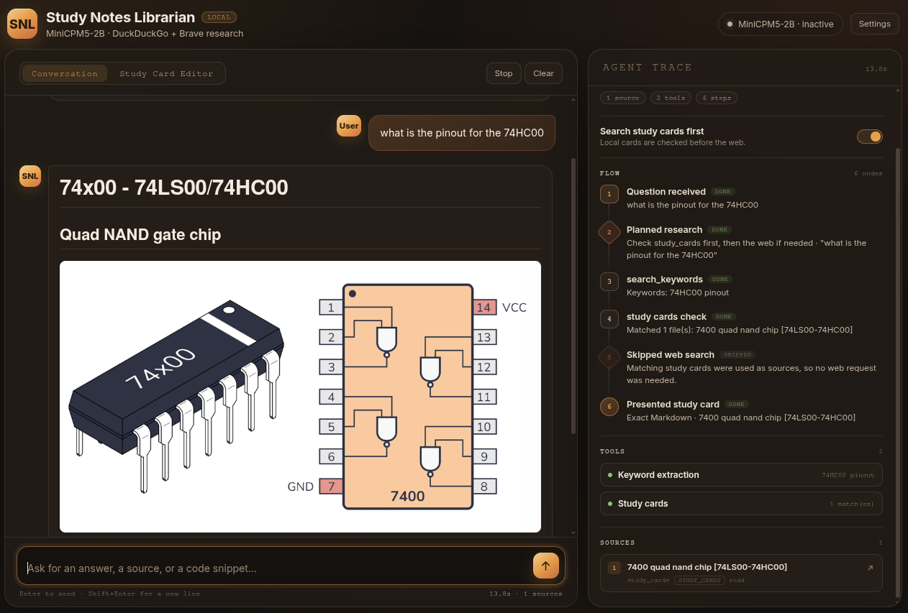
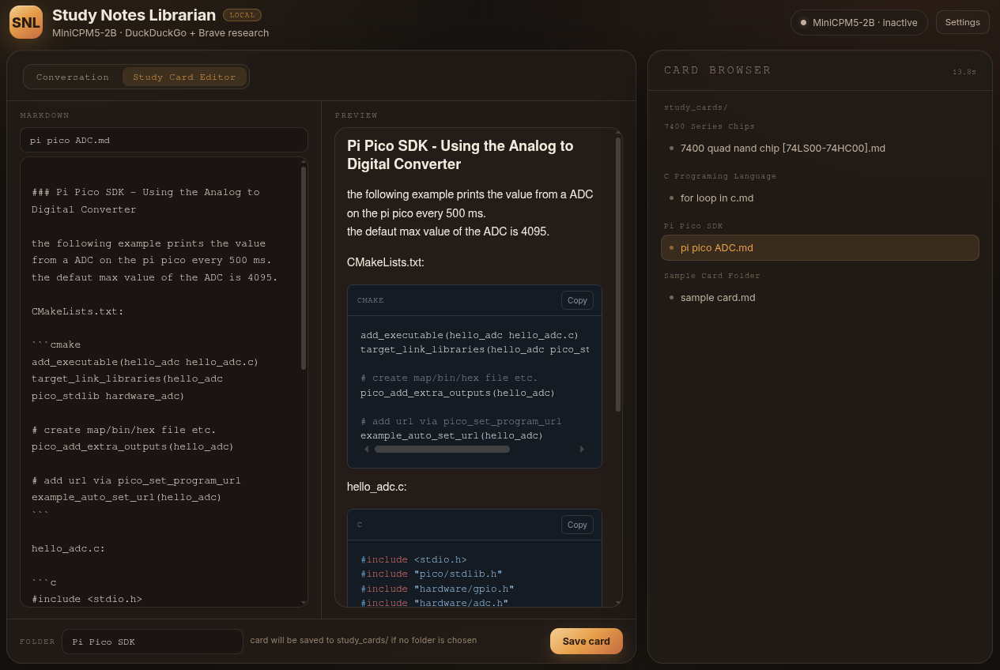

# Study-Notes-Librarian
Study-Notes-Librarian is a privacy focused search AI agent based on MiniCPM5-2B, served locally by llama.cpp. By default It will search the folder "study_cards" with your search query and if nothing is found it will automatically search the web, using Brave Search and Duck Duck Go.

## Privacy and Transparency
Study-Notes-Librarian prioritizes searching your "study_cards" folder first, you are encouraged to create study_cards for often searched subjects. It uses the privacy focused search engines [Brave Search](https://search.brave.com/) and [DuckDuckGo](https://duckduckgo.com/) when searching online. The model runs in a llama.cpp server on your machine, so your data wont be sent to any AI provider. Searching can also be accomplished offline, but will only yield results from your study_cards folder, and the query will be processed locally on your machine. Each step the agent took to reach the answer is also presented in a flow-chart along with the search sources.




## TODO
- [x] Add study card editor
- [x] Add configuration page
- [x] Add card browser to card editor
- [x] Refactor code (code works but its a mess)
- [x] Add option to delete cards on the card browser

## Install
Get a free Brave Search API key here: https://brave.com/search/api/. Brave Search wont work without this.

#### Linux
Run ```run.sh``` then access [http://127.0.0.1:5000/](http://127.0.0.1:5000/) on your browser.

#### Windows
Run ```run.bat``` then access [http://127.0.0.1:5000/](http://127.0.0.1:5000/) on your browser.

The scripts installs llama.cpp if needed, downloads the model, starts the llama.cpp server on `127.0.0.1:5001`, then launches the app.  

#### Settings
On the upper right corner click on settings, add your Brave Search API key then click on save changes. Model and llama.cpp server settings apply after a restart.

#### Configuration File
if you need to edit the configuration file manually,  open the file ```.env``` on a text editor.

## Tests
The integration tests exercise the app end-to-end against the real model and need a running llama.cpp server. Start it first (for example with ```./run.sh``` in another terminal), then run the tests from the project root:

```
.venv/bin/python -m unittest discover -s tests
```

Tests that need the model are skipped when the llama.cpp server is not reachable.

## License
Study-Notes-Librarian was made using GLM 4.6(Big Pickle) and is MIT licensed
