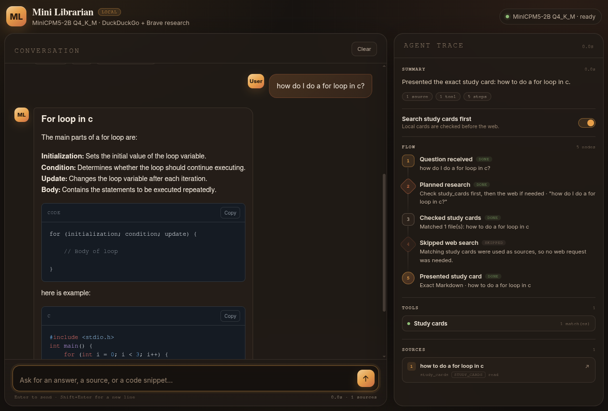
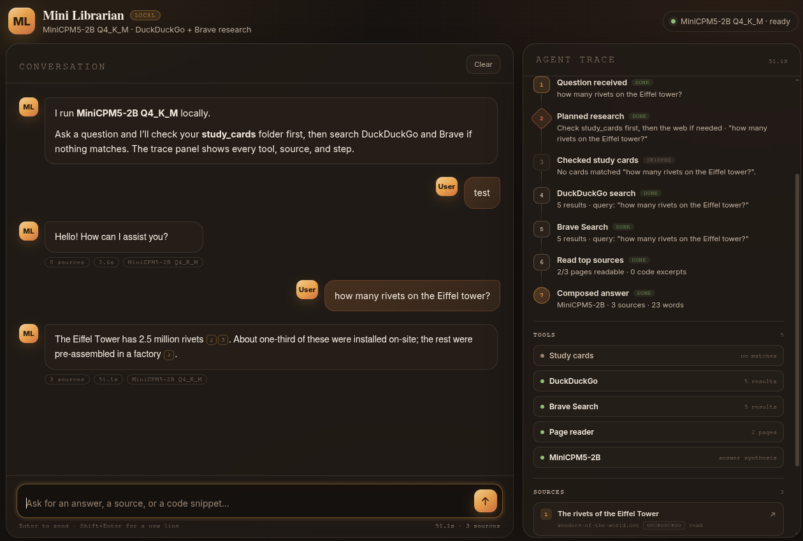

# Study-Notes-Librarian
Study-Notes-Librarian is a privacy focused search AI agent based on MiniCPM5-2B, indented to be used locally. By default It will search the folder "study_cards" with your search query and if nothing is found it will automatically search the web, using Brave Search and Duck Duck Go.

## Privacy and Transparency
Study-Notes-Librarian prioritizes searching your "study_cards" folder first, you are encouraged to create study_cards for often searched subjects. It uses the privacy focused search engines [Brave Search](https://search.brave.com/) and [DuckDuckGo](https://duckduckgo.com/) when searching online. when using this app your data wont be sent to any AI provider. Searching can also be accomplished offline, but will only yield results from your study_cards folder, and the query will be processed locally on your machine. Each step the agent took to reach the answer is also presented in a flow-chart along with the search sources. 




## TODO
- [ ] Add study card editor
- [x] Add configuration page

## Install
Get a free Brave Search API key here: https://brave.com/search/api/. Brave Search wont work without this.

#### Linux
Run ```run.sh``` then access [http://127.0.0.1:5000/](http://127.0.0.1:5000/) on your browser. 

#### Windows
Run ```run.bat``` then access [http://127.0.0.1:5000/](http://127.0.0.1:5000/) on your browser.

#### Settings
On the upper right corner click on settings, add your Brave Search API key then click on save changes.

#### Configuration File
if you need to edit the configuration file manually,  open the file ```.env``` on a text editor.

## License
Study-Notes-Librarian was made using GLM 4.6(Big Pickle) and is MIT licensed
